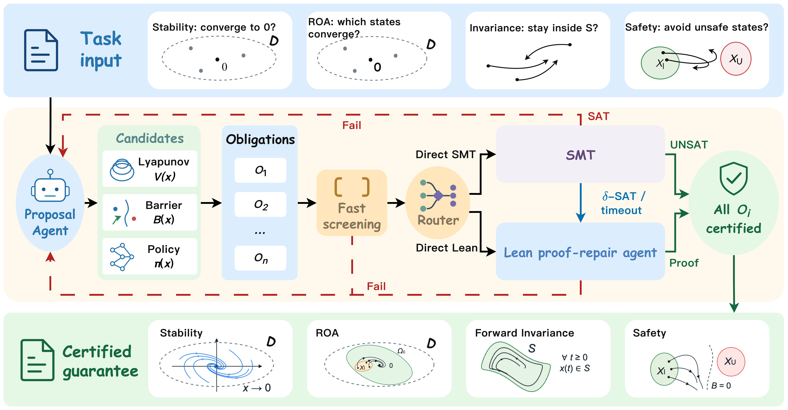

# LLM2Cert

This repository holds code and data for **LLM2Cert: LLM Synthesis of Certificates with SMT/Lean Verification**.

Zhipeng Cao*, Peiyang Song*, Nikolaus Vertovec, Weiru Cui, Zhihao Yang, Mingkang Liu, Luxia Lin, Bai Xue†, Alessandro Abate†  

*Equal contribution. †Equal advising.

[Project website](https://formalcert-ai.github.io/llm2cert/) · [Paper](https://arxiv.org/abs/2610.30524) · [Running the experiments](docs/RUNNING.md) · [Recorded results](results/README.md)

LLM2Cert synthesizes Lyapunov functions, barrier certificates, and feedback policies, then verifies their obligations with SMT solvers and Lean. The repository includes DynaCertBench, with 105 stability, region-of-attraction, forward-invariance, and safety problems.



## Repository structure

- [`llm2cert/`](llm2cert): the certificate pipeline, runtime configuration, and Lean formalization.
- [`data/`](data): benchmark problems and their literature sources.
- [`benchmark/`](benchmark): fixed-certificate verification, proof-repair experiments, and plotting scripts.
- [`results/`](results): Main and RQ1–RQ3 results, saved model outputs, and frozen inputs.
- [`scripts/`](scripts): checks and offline result calculations.

## Installation

Use Python 3.12. The Lean project and solver requirements are described in the [running guide](docs/RUNNING.md).

```bash
git clone https://github.com/FormalCert-AI/llm2cert.git
cd llm2cert
python3.12 -m venv .venv
source .venv/bin/activate
python -m pip install -e llm2cert/framework
```

Unpack the recorded experiments before recomputing results or replaying frozen inputs:

```bash
python scripts/unpack_records.py
```

## Recorded results

```bash
python scripts/verify_release.py
python scripts/export_results.py
python benchmark/run_frozen_repair.py validate
```

The calculations use saved records and make no model calls. Browse the [Main experiment](results/main), [RQ1](results/rq1), [RQ2](results/rq2), and [RQ3](results/rq3) by problem ID. Each directory includes readable model outputs and an archive of its execution records. See the [result definitions](docs/PAPER_RESULT_MAP.md) for the selection and accounting rules.

## Run an experiment

Copy `.env.example` to `.env.local` and enter your model API key and endpoint. Set the Lean and solver paths in `llm2cert/config/runtime.example.json`.

```bash
cp .env.example .env.local
set -a
source .env.local
set +a
export DYNACERT_RUNTIME_MANIFEST="$PWD/llm2cert/config/runtime.example.json"

python llm2cert/run_pipeline.py "$PWD/data/dynacertbench_executable.json" DCB-LIT-P4-025
```

To run all 105 problems:

```bash
python llm2cert/run_dataset.py --workers 8
```

The [running guide](docs/RUNNING.md) also covers backend ablations, frozen-certificate replay, proof repair, and figure generation. New model runs use your API credits and can differ from the saved results.

## Citation

```bibtex
@misc{cao2026llm2cert,
      title={LLM2Cert: LLM Synthesis of Certificates with SMT/Lean Verification}, 
      author={Zhipeng Cao and Peiyang Song and Nikolaus Vertovec and Weiru Cui and Zhihao Yang and Mingkang Liu and Luxia Lin and Bai Xue and Alessandro Abate},
      year={2026},
      eprint={2610.30524},
      archivePrefix={arXiv},
      primaryClass={eess.SY},
      url={https://arxiv.org/abs/2610.30524}, 
}
```

## License

[MIT](LICENSE). See [third-party notices](THIRD_PARTY_NOTICES.md) for dependency licenses.
